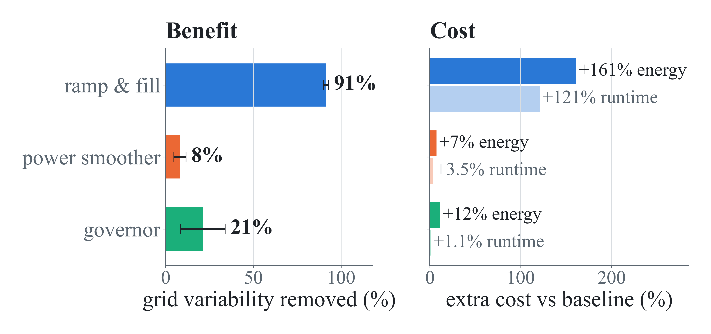

# Collecting and Adjusting Server Power

Companion code, measurements, and analysis for **Smoothing Synchronized Power
Swings in HPC Clusters Using Software: Measurement, Prediction, and Grid
Simulation**, by Daniel Lee, Emily Doyle, and Alexander Johnson.

Bulk-synchronous workloads make servers compute and communicate together. Their
power swings add in phase, making software control of one server relevant to a
whole fleet. This study measures one server, compares three smoothing methods,
and simulates 10,000 identical servers on a weak 50 MW grid behind a 15 s UPS
low-pass filter.

**Poster:** [PDF](Deliverables/Poster/APS-poster-Lee-48x36-v3-mlstyle_proof.pdf)
· [PowerPoint](Deliverables/Poster/APS-poster-Lee-48x36-v3-mlstyle.pptx)
· [results and data sources](Code/grid-simulation/POSTER_DATA.md).
The [earlier paper](Deliverables/Paper/draft.pdf) and its
[data sheet](Code/grid-simulation/PAPER_DATA.md) retain the original analysis.

## Results presented in the poster

Three workloads (HPL, AI inference-style load, and step), four conditions, and
four repeat collections give **48 measured traces** on a quiesced dual Xeon
Gold 6338 server. Each mitigation is compared with its own workload's baseline.

| Mitigation | Grid variability reduction | Extra runtime | Extra CPU energy |
|---|---:|---:|---:|
| **Ramp & fill (`rampc`)** | **91.4 ± 1.4%** | +121.1 ± 5.7% | +161.0 ± 6.7% |
| Power smoother (`powersmoother`) | 8.2 ± 3.5% | +3.5 ± 0.2% | +7.4 ± 0.6% |
| Governor (`usagegov`) | 21.2 ± 12.7% | +1.1 ± 1.9% | +11.6 ± 1.5% |

Variability is the coefficient of variation (CV) of simulated facility power
after the UPS. Values average the three workloads within each run, then report
mean ± sample SD across four runs. Grid scores exclude the first 30 s and score
ramp & fill's workload plateau; runtime and CPU energy include the entire trace,
including the ramp flanks. The poster rounds the reductions to 91%, 8%, and 21%.



Ramp & fill gives the strongest smoothing at substantial cost. The governor
provides a smaller, more variable reduction with little runtime overhead.
Voltage is the limiting quantity in this simulated scenario: the worst baseline
falls below the study's 0.95 pu threshold near 10,000 servers. At 20,000 servers,
the corrected frequency nadir is 59.654 Hz, above the study's 59.3 Hz reference.
These are scenario results for synchronized copies of one measured server.

### Why these results differ from the earlier paper

The original Simulink outputs include a fixed 4.104 MW initial load and a
4.4655 MW swing-equation operating point baked into the model. The October
re-analysis sets the operating point per trace, starts the frequency response
at equilibrium, and excludes 30 s (two UPS time constants). All three methods
then reduce variability; the earlier analysis reported a reduction only for
ramp & fill. A 45 s sensitivity check gives reductions of 91.4%, 8.1%, and
28.2%, respectively. Runtime and energy costs are unchanged.

[`rescore_warm.py`](Code/grid-simulation/analysis/rescore_warm.py) implements the
Python replica and checks it against the original Simulink outputs.
[`POSTER_DATA.md`](Code/grid-simulation/POSTER_DATA.md) documents the corrected
results, voltage chart, assumptions, and provenance. Original simulation
outputs and paper tables remain available for comparison.

## Measurement and detection

The live monitor combines 10 Hz RAPL CPU power, 1 Hz Linux `/proc` telemetry,
Redfish BMC data every 10 s, and rack PDU power at about 1.8 Hz in InfluxDB and
Grafana. The poster reports sampling overhead of 2.19% of one core (0.017% of
this 128-thread server) and +0.15 W for the sampling daemon. RAPL power is
reported only when the energy counter advances, avoiding false kilowatt spikes.

The forecasting experiments did not establish reliable advance warning at the
available telemetry rates. OLS caught 19 of 1,735 spikes; the random forest plus
Kalman filtering achieved PR-AUC 0.68 but flagged transitions 10–20 s late.
The final CPU-utilization edge detector responds in about one 10 Hz sample.
On a separate workload collection, the governor's actuator moved a median
**0.23 s after** the transition, with 33% recall and 19% precision; phase anchors
have ±0.5 s uncertainty. See [prediction](Code/prediction/README.md) and
[detector data](Code/grid-simulation/data/detector/README.md).

## Repository layout

| Directory | Role |
|---|---|
| [Code/measurement](Code/measurement/) | RAPL, system, BMC, and PDU telemetry into InfluxDB |
| [Code/prediction](Code/prediction/) | Forecasting experiments and detector evaluation |
| [Code/mitigation](Code/mitigation/) | Ramp & fill, power smoother, and slew governor |
| [Code/grid-simulation](Code/grid-simulation/) | Fleet aggregation, grid model, scoring, and data |
| [Code/workloads](Code/workloads/) | HPL, AI-style load, and stepped-load benchmarks |
| [Code/cluster-profiling](Code/cluster-profiling/) | Fleet duty-cycle visualization |
| [Deliverables/Poster](Deliverables/Poster/) | Supplied poster, PDF proof, and result figures |
| [Deliverables/Paper](Deliverables/Paper/) | Earlier technical paper |
| [Deliverables/Presentations](Deliverables/Presentations/) | Earlier presentations |

## Reproduce the poster's grid results

From the repository root, with Python 3 and NumPy/SciPy installed:

```bash
python3 -m pip install -r Code/grid-simulation/requirements.txt
cd Code/grid-simulation
python3 analysis/rescore_warm.py --selfcheck
python3 analysis/rescore_warm.py          # CV, voltage swings, fleet-size sweep
python3 analysis/summarize_n4.py          # full-trace runtime/energy; original grid scores
python3 analysis/score_detector.py        # independent detector evaluation
```

The corrected tables are in `Code/grid-simulation/data/summary/rescored/`.
No MATLAB or instrumented server is required for these commands. Older figure
scripts reproduce the original paper's analysis; see the
[figure guide](Code/grid-simulation/figures/README.md).

Regenerating the original Simulink outputs requires MATLAB R2025a and Simscape
Electrical; see the [grid simulation guide](Code/grid-simulation/README.md).
Live collection and actuation require the instrumented Linux server, appropriate
RAPL permissions, and configured telemetry services. Deployment units contain
site-specific paths. Component READMEs describe hardware requirements and which
checks can run offline.

## Data availability

Raw experiment traces, simulation outputs, exported model, and analysis summaries
are committed. Large telemetry caches and dated training pickles are omitted;
`Code/prediction/telemetry/` can regenerate caches from the original InfluxDB.
Governor event logs for the main matrix were not retained, so detector quality
uses the separate collection documented above.

## Contributors and acknowledgments

Daniel Lee (Grinnell College), Emily Doyle (Embry-Riddle Aeronautical University),
and Alexander Johnson (Georgia Institute of Technology). The AI-style workload,
stepped-load generator, and composite ramp were contributed by collaborators.

The poster acknowledges Stewart Baker and Erin Carrick for guidance and the
Laboratory for Physical Sciences for support during the 2026 Future Computing
Summer Internship at the National Security Agency. AI tools assisted software
testing and implementation.

## License

MIT — see [LICENSE](LICENSE).
